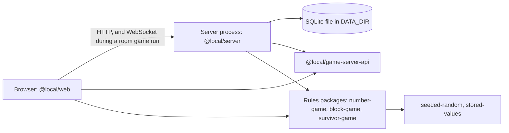
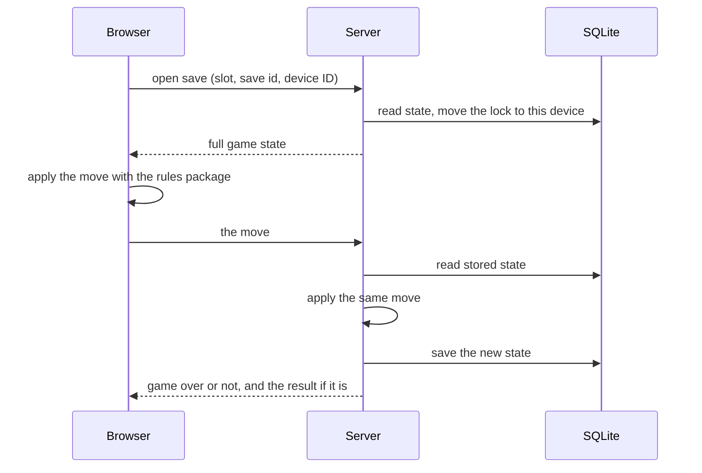
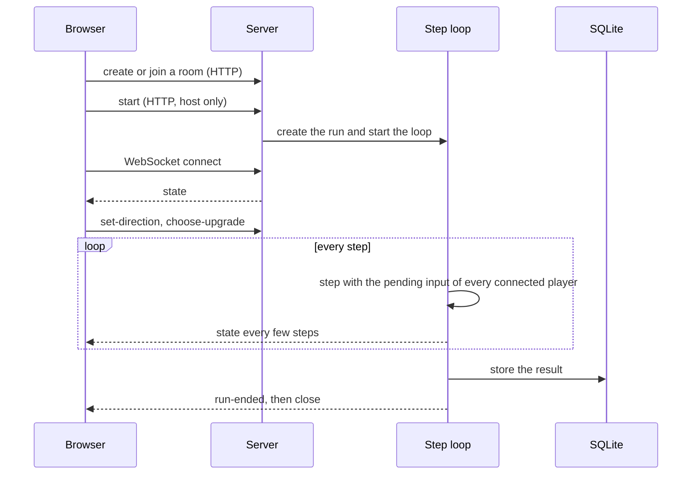

# Architecture

This file holds how the code is divided, the rules it must follow, how data moves through it while it runs, and where new code goes. It never holds setup, configuration, API reference, test details, history, or plans. The requirements behind these choices are in the `REQUIREMENTS/` folder.

## Structure

The repository is one npm workspace. Each part has these jobs and limits:

| Part | Owns | Must not | May depend on |
| --- | --- | --- | --- |
| `packages/seeded-random` | The seeded random number generator ([README](packages/seeded-random/README.md)) | Contain browser or server code | Nothing |
| `packages/stored-values` | The checks every game uses to read a stored value back, and the type of a stored format upgrade ([README](packages/stored-values/README.md)) | Contain browser or server code | Nothing |
| `packages/game-server-api` | TypeBox schemas of every server request body and answer | Contain game rules | Nothing |
| `packages/number-game` | The Number Game rules ([README](packages/number-game/README.md)) | Contain browser or server code, or use another game's rules package | `seeded-random`, `stored-values` |
| `packages/block-game` | The Block Game rules ([README](packages/block-game/README.md)) | Contain browser or server code, or use another game's rules package | `seeded-random`, `stored-values` |
| `packages/survivor-game` | The Survivor Game rules, including the WebSocket messages ([README](packages/survivor-game/README.md)) | Contain browser or server code, or use another game's rules package | `seeded-random`, `stored-values` |
| `apps/server` | Players, saves, and high scores in SQLite, applying moves, rooms and runs of room games, and serving the built browser app ([README](apps/server/README.md)) | Contain the rules of a specific game in shared code | `game-server-api`, `stored-values`, and the rules packages |
| `apps/web` | The dashboard, the game pages, and each game's play screen ([README](apps/web/README.md)) | Decide a result of a saved game or a run on its own, or contain the rules of a specific game in shared code | `game-server-api` and the rules packages |

Dependencies only point one way: the apps use the packages, the game rules packages use `seeded-random` and `stored-values`, and the packages use neither app.

## Design

- Packages hold the rules. The rules of a game are plain TypeScript with no browser or server code, so the browser and the server run the same function. (PL-04)
- The server is the source of truth. A saved game is changed only by moves the server applies itself, and a run of a room game is stepped only by the server, so a changed browser cannot save an impossible board or a fake score. (PS-07, SG-58)
- Neither side trusts the other. The browser sends moves, not states, and checks every server answer with the shared schemas. The server checks every request with TypeBox schemas, every WebSocket message with the game's check, and every stored value with the rules package.
- Randomness is seeded. A game keeps its random generator state inside its state, and the server picks the seed, so the rules package has no hidden randomness, the browser and the server make the same numbers for the same move, and a save loaded on another device continues with the same upcoming numbers. (NG-02, NG-17, SG-59)
- Shared code never contains rules for a specific game. The dashboard, players, high scores, game pages, save slot and move routes, and room code work with any registered game through its id. (PL-04, PL-05, PL-06, PL-17, PL-21)
- Stored formats are versioned. Game states and high score summary details carry the format version of the game that wrote them, and each game keeps its own upgrade list, so an old save is upgraded and checked before use and never loaded unchecked.
- A run of a room game is plain data that survives JSON, and its shared room code never looks inside it, so a new room game needs no change to the shared code.
- Sounds and effects only show what happened and never change the game state. (PL-18)
- Time is injected. Step loops, connection checks, and the waiting room expiry take their clock and timer from a `StepScheduler`, so tests move time by hand.
- A run state is cut down before it is sent. A full run state is too large to send many times a second, so only a `RunStateReport` is sent. The figures are in `apps/server/README.md`.
- Each run is stepped many times a second, so the number of rooms that exist at once is limited by a setting. (SG-09)

## Data flow

A saved game move:

1. The browser opens the save named in the page link, by slot and save id, and receives the full game state.
2. The player makes a move, such as a match. The browser applies it right away with the rules package so the screen responds instantly.
3. The browser sends the move, not the new state, to the server.
4. The server checks that the slot still holds this save and that this device holds the lock, applies the same move to its stored state with the same rules package, and saves the result. It answers only whether the game is over, and the result that went into the high scores if it is.
5. If the server refuses the move, the browser shows the reason and offers to reload the server state. If the slot no longer holds this save, it offers the save slots and the dashboard instead. (PS-07, PS-08, PS-18, PS-19)

A room game run:

1. A player creates a room or joins one over HTTP. The host starts it, and the server creates the run with a random seed and starts one loop for the room.
2. Each browser opens a WebSocket for its room and player ID. The server answers with the current state.
3. The browser sends only a direction when it changes and upgrade choices, and draws every state it receives.
4. The loop steps the run at the step rate with the pending input of every connected player, and sends a state to every connected player every few steps.
5. When the run is over, the server stores the result for every player on the team, sends `run-ended`, closes the sockets, stops the loop, and deletes the room. (SG-48, SG-49, SG-60)

The messages and routes are in `API.md`, and the loop in `apps/server/README.md`.

## Systems

### Saved games

- Owner: the rules package of each game, with the shared save slot and move routes in `apps/server` and the game page in `apps/web`.
- Rules: the server applies every move, a save belongs to the device that opened it last (PS-18), and every new game has its own save id (PS-19).
- Detail: `API.md`, `REQUIREMENTS/players-saves-scores.md`, and `apps/web/README.md`.

### Room games

- Owner: the shared room code in `apps/server/src/rooms/` and `apps/web/src/rooms/`, and the game's rules package.
- Rules: rooms live in memory, a player ID is in at most one room (SG-05), the server runs the game (SG-58), and a dropped player can rejoin (SG-44 to SG-47).
- Detail: `API.md` for routes, messages, and close codes, `apps/server/README.md` for rooms, the step loop, and the connection checks, and `REQUIREMENTS/survivor-game/rules.md`.

### High scores

- Owner: `apps/server/src/database/high-scores-store.ts`, with each game's summary function.
- Rules: a result names one or more players (PS-23), is written together with its player rows, and is written when a game or a run ends (SG-49).
- Detail: `API.md` and `apps/server/README.md`.

### Randomness

- Owner: `packages/seeded-random`.
- Rules: the generator state is part of the game state, and the server picks the seed.
- Detail: `packages/seeded-random/README.md`.

### Storage

- Owner: `apps/server/src/database/` and `apps/server/src/games/stored-format.ts`.
- Rules: one SQLite file in `DATA_DIR`, with tables created and upgraded by migrations at startup (PS-03, PS-13), and stored JSON upgraded and checked before use.
- Detail: `apps/server/README.md` and `packages/stored-values/README.md`.

### Configuration

- Owner: `apps/server/src/config.ts`.
- Rules: every setting is read from environment variables at startup, and an invalid value stops the server with a clear error. (PL-12)
- Detail: `GUIDE.md`.

### Sound

- Owner: `apps/web/src/audio/`.
- Rules: the shared player plays tones and recorded clips, and keeps the mute choice on the device. (PL-18, PL-19)
- Detail: `apps/web/README.md` and `apps/web/src/audio/clips/CREDITS.md`.

## Extending

A game is one of two kinds (PL-21). A saved game is played by one player in a save slot, one move at a time. A room game is played live by one to four players in a room. The registries hold both kinds in one list, and every module has a `kind` field (`'saved'` or `'room'`).

| Adding | Goes in |
| --- | --- |
| A saved game: rules | A new `packages/<game>` with a `README.md` that lists its files. It owns the game id, the state type, the move type, the function that applies any move, the summary for save slots and high scores, the checks that read stored states and summary details back, and the upgrade lists |
| A saved game: server | `apps/server/src/games/<game>.ts` with the schemas of the new game options and the moves, which it checks when it compiles against the rules package move type, listed in `apps/server/src/games/create-game-registry.ts`. The shared routes need nothing |
| A saved game: browser | `apps/web/src/games/<game>/<game>-module.ts` with a name, a description, the high score categories, a way to label the summary details, and dynamic `import()` loaders for the new game options form and the play screen. Listed in `apps/web/src/games/create-browser-game-registry.ts` |
| A room game: rules | A new `packages/<game>` with a run state, one pure step function, the function that starts a run from player IDs and a seed, the room limits, the balance values, the WebSocket messages and their checks, the step rate, the empty run time, how a refused input is reported, the function that ends a run nobody is connected to, the summary of a finished run, and the check and upgrade list for stored summary details. It has no stored state format |
| A room game: server | `apps/server/src/games/<game>.ts` giving `defineRoomGame` in `apps/server/src/games/room-game.ts` a definition (the parts are listed in `apps/server/src/games/README.md`), listed in `create-game-registry.ts`. The shared room code needs nothing |
| A room game: browser | `apps/web/src/games/<game>/<game>-module.ts` with a name, a description, the high score categories, a way to label the summary details, and one loader for the play screen, listed in `create-browser-game-registry.ts`. The game page shows the room list, so no new game form is needed |
| Any new game package | The workspace list in the root `package.json`, in build order with dependencies first, the three `COPY` lines in the `Dockerfile`, and the dependency in `apps/server/package.json` and `apps/web/package.json` |
| Any new game's requirements | A folder `REQUIREMENTS/<game>/` and a row in `REQUIREMENTS/README.md` |
| A game removed | A database migration that deletes its saves and high scores, since no code is left to read them |
| A new route | A file in `apps/server/src/routes/`, its schemas in `packages/game-server-api`, and `API.md` |
| A new setting | `apps/server/src/config.ts`, `.env.example`, `compose.yaml` if needed, and `GUIDE.md` |
| A new page | `apps/web/src/pages/`, its path in `apps/web/src/routing/`, and `apps/web/README.md` |
| A new database table or column | A migration in `apps/server/src/database/migrations.ts` and a store in the same folder |
